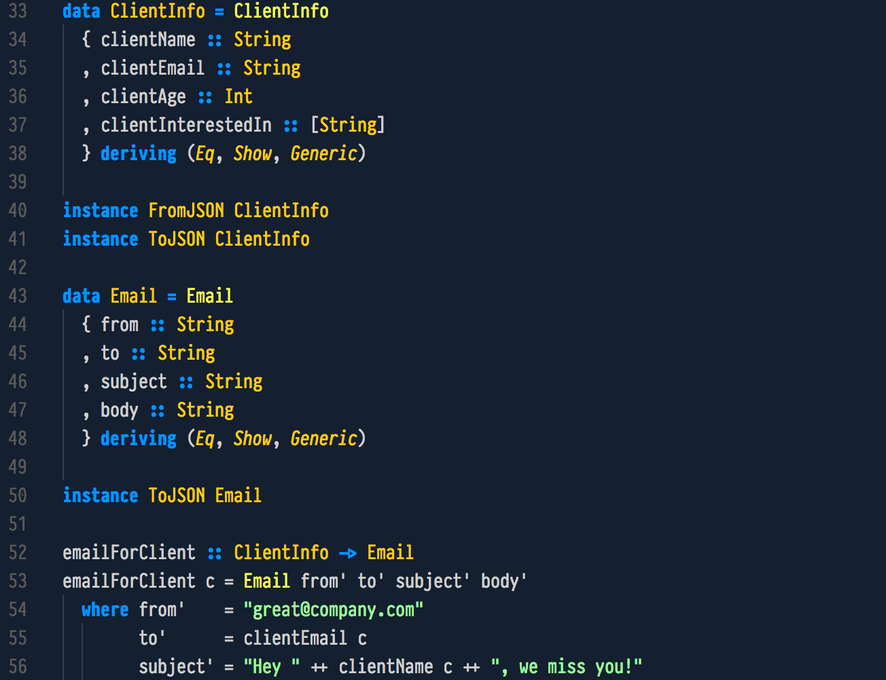

# BlueForest Theme

A dark blue theme inspired by the
[BlueForest IntelliJ theme](https://github.com/sirthias/BlueForest), optimised
for syntax highlighting in a wide range of languages.

The theme is available for the following applications:

| Application | Documentation                  |
| ----------- | ------------------------------ |
| VS Code     | [VS Code](themes/vscode.md)    |
| bat         | [bat](themes/bat.md)           |
| Neovim      | [Neovim](themes/neovim.md)     |
| Starship    | [Starship](themes/starship.md) |
| OpenCode    | [OpenCode](themes/opencode.md) |
| sbt         | [sbt](themes/sbt.md)           |
| eza         | [eza](themes/eza.md)           |
| Zed         | [Zed](themes/zed.md)           |
| Yazi        | [Yazi](themes/yazi.md)         |
| kitty       | [kitty](themes/kitty.md)       |

Every application has its own installation page. Each page explains how to
install the theme with Nix, how to install it by hand, and how to select it
once it is installed.

## Installing

The recommended way to install the theme depends on the application. The
[VS Code theme](themes/vscode.md) is published to
[Open VSX](https://open-vsx.org/extension/alonsodomin/blueforest-theme),
which is the recommended source for VS Code-compatible editors. The other
themes are published as assets of the
[GitHub releases](https://github.com/alonsodomin/blueforest-theme/releases),
and every one of them can also be installed with Nix.

The repository is a Nix flake, and the [installation page](installation.md)
explains how to take the whole flake, a single application, or the overlay
alone.

## Supported languages

The theme has been optimised for:

- Bash
- C / C++
- GLSL
- Golang
- Groovy
- Haskell
- HTML
- Java
- JSON
- Markdown
- Powershell
- Python
- Scala
- HTML / XML
- YAML

## Hacking

The repository is a Nix flake monorepo, and every application is a flake of
its own. If you want to work on the theme itself, read the
[Hacking section](hacking/index.md). It covers the repository layout, the
development shell, the checks, the workflows, and the release process.

## License

The theme, its images, and its documentation are licensed under the
[Creative Commons Attribution 4.0 International licence](license.md). The code
that packages the theme is licensed under the
[Mozilla Public License 2.0](license.md).
